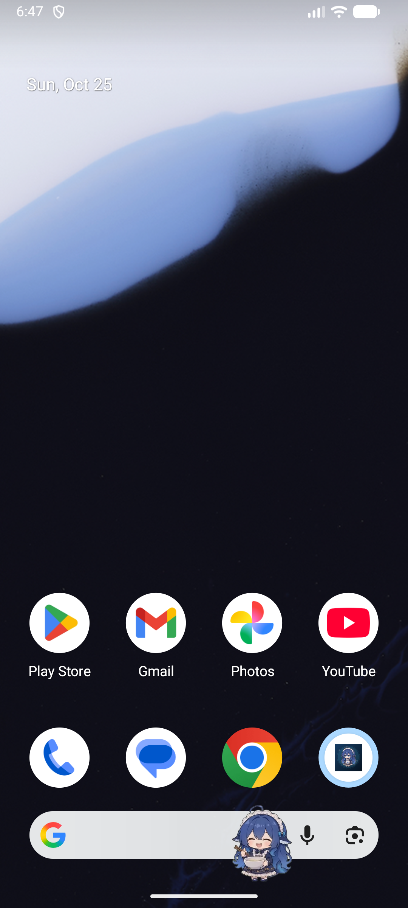
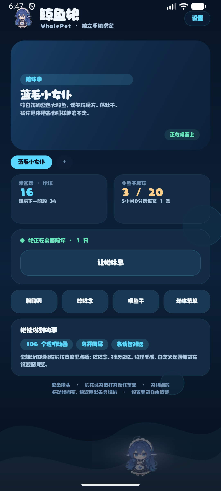
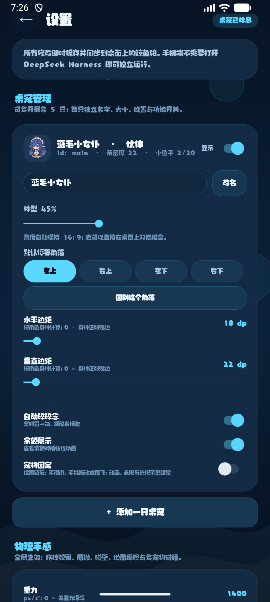

# 鲸鱼娘 WhalePet · Android 桌面宠物

一只住在手机桌面上的 Q 版鲸鱼娘。透明视频、漫游、拖拽甩飞、AI 对话与养成，离线也能跑；填上 API Key 后变成真 AI 女仆。

> 本项目是 [dsh-pet](https://github.com/PC2005-cloud/dsh-pet) 的 **Android 移植版**。角色的动画素材、动作分类、玩法与物理手感都来自上游，这里把它们搬到 Android 的悬浮窗（`TYPE_APPLICATION_OVERLAY`）+ WebView 上，并用 Kotlin 重写了全部宿主逻辑。上游以 MIT 协议发布，本仓库同样以 MIT 发布，详见[素材与版权](#素材与版权)。

| 桌面效果 | 主页 | 设置 |
| --- | --- | --- |
|  |  |  |

## 功能

- **真透明动画**：106 个带 alpha 通道的 VP9 WebM 动作，WebView 双 `<video>` 交替播放 + canvas 冻结帧 + 首帧上屏后再切换，换动作不闪黑也不闪灰白。
- **多宠同屏**：最多 5 只，每只独立悬浮窗、独立尺寸/位置/开关，互不遮挡触控。
- **手感**：拖拽弹簧跟手、松手惯性甩飞、落地挤压回弹、左右贴边；窗口只覆盖角色本身，不会整屏吃触摸。屏幕边界只取一次并缓存，高刷屏拖拽不再每帧跨进程查询。
- **互动**：点按摸头回应，长按打开面板菜单——6 个快捷操作（对话 / 碎碎念 / 喂食 / 余额 / 回原位 / 固定在此处），下方按分类切换动作，分类标签等宽铺满整行，动作不满一行时自动占满。
- **宠物固定**：位置锁死，不漫游不甩飞，动画与点按照常；重启后仍停在原地。
- **AI 陪伴**：DeepSeek API 对话、上下文记忆、对话配图、联网碎碎念、余额查询与档位动画；不填 Key 时使用本地人格聊天，不消耗 token。
- **可调性**：体型、角落/自由位置、边距、物理参数（重力/弹性/摩擦/抛掷力度）、碎碎念间隔、自定义 WebM 动画导入、边界校准。

## 与上游的差异

| 项目 | 上游 dsh-pet | 本项目 |
| --- | --- | --- |
| 形态 | DSH 插件（浏览器内 + Electron 桌面小窗） | 独立 Android App |
| 安装 | `dsh plugin add` / 应用内插件管理 | 侧载 APK |
| 菜单 | 右键菜单 | 长按宠物弹出底部面板 |
| 配置 | `main-config.jsonc` 文件 | SharedPreferences + JSON（`ConfigStore` 单例） |
| 渲染 | DOM 元素 + WebM | 每个宠物一个悬浮窗 + WebView 播放 WebM |
| 物理 | 纯函数物理（`shared/physics.ts`） | Kotlin + `Choreographer` 逐帧积分（弹簧拖拽、抛掷、挤压回弹） |
| 额外能力 | 打开网站 / 重载配置 | 桌宠固定、余额档位动画、自定义动画导入、边界校准 |

玩法、动画素材与美术资源均沿用上游；Android 端的悬浮窗管理、手势、菜单、设置页、AI 对接与养成是重写的。

## 环境要求

- Android 13（API 33）及以上
- 构建需要 Android Studio Ladybug 或更新版本，JDK 17+

## 构建

```bash
git clone https://github.com/<你的用户名>/<仓库名>.git
cd <仓库名>
./gradlew assembleRelease
```

Windows 下把 `./gradlew` 换成 `gradlew.bat`。产物在 `app/build/outputs/apk/release/app-release.apk`；也可以直接用 Android Studio 打开本目录后点 Run。

> release 目前复用 debug 签名，方便侧载安装。仓库不提交 APK（`.gitignore` 已排除 `*.apk`），安装包建议放在仓库的 Releases 页。若要上架或长期维护，请替换成自己的 keystore。

## 安装与首次使用

1. 下载 Release 里的 APK，允许「安装未知应用」后安装。
2. 打开 App，授予「显示在其他应用上层」权限（Android 13+ 还需通知权限）。
3. 点「放出鲸鱼娘」，桌面右上角即出现角色。
4. 长按宠物打开菜单：可以对话、换动作、喂食、固定位置。
5. 设置页里调整体型/位置、添加第二只、填 DeepSeek API Key、导入自定义动画。

> MIUI / 部分国产 ROM 覆盖安装后会重置悬浮窗权限或「放出」状态：如果桌面上没有角色，回到 App 点一次「放出鲸鱼娘」即可。

## 技术栈

- Kotlin + AppCompat，单 Activity + 悬浮窗（`TYPE_APPLICATION_OVERLAY`，窗口严格等于角色尺寸）
- WebView 内 `player.html` 播放 `assets/pet/*.webm`（VP9 + alpha），`noCompress` 保证不被打包压缩
- 配置 JSON 持久化（`SharedPreferences` + `ConfigStore` 单例，变更即时同步到悬浮窗）
- `Choreographer` 驱动的弹簧拖拽、抛掷物理、漫游与挤压动画；屏幕边界做缓存，避免逐帧跨进程查询

## 目录结构

```
app/src/main/
├── java/com/whale/pet/    # 悬浮窗、菜单、设置、AI、养成等
├── assets/pet/            # 角色动画（透明 WebM）+ player.html
├── assets/memes/          # 表情包
├── assets/fonts/          # 字体
└── res/                   # 图标与主题
```

## 素材与版权

- **代码**：MIT License（见 [LICENSE](LICENSE)）。Android 端代码与上游 [dsh-pet](https://github.com/PC2005-cloud/dsh-pet)（MIT, Copyright © 2026 PC2005-cloud）的玩法设计共同构成本项目。
- **角色动画、表情包**：沿用上游素材，来自网络的同人/公开素材，仅供学习与个人使用，版权归原作者所有；MIT 协议**不覆盖**这些素材。若要商用或再分发，请替换为你自己拥有授权的资源。
- **字体**：「上首软糖体」请自行确认授权范围后再用于分发。

## 已知限制

- 动画依赖 WebView 的 VP9 alpha 解码，极少数老旧机型可能显示黑底或掉帧。
- 悬浮窗按角色矩形完全拦截触摸（矩形内的透明区域也不穿透），以免误触下层桌面图标。
- 未配置 API Key 时没有联网碎碎念与余额查询。
- 未做后台常驻优化：系统清理后台后需要回到 App 重新放出。
